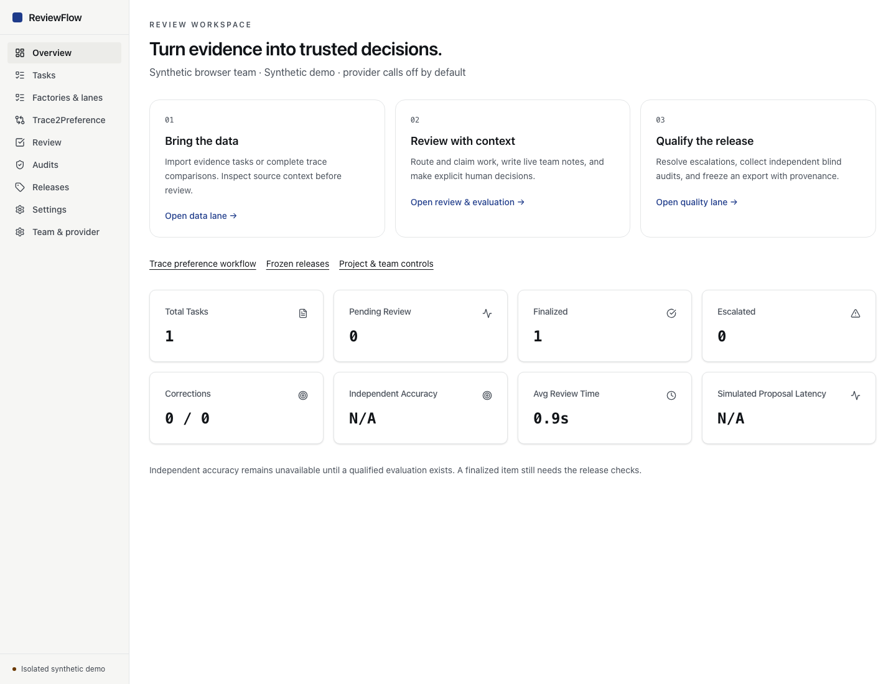

# ReviewFlow

ReviewFlow is an **experimental local review application** with three workloads:
evidence labeling, a versioned **Rubric factory**, and **Trace2Preference**, which turns
authorized observable agent-run exports into human-reviewed comparison datasets.
Demo fixtures and no-key proposals are explicitly simulated—not production
traces, independent human reviews, or evidence of model quality.

Model proposals are suggestions, not ground truth. Human corrections retain the
reviewer's decision, reason, and provenance; exports preserve those judgments
rather than silently replacing them with a later model result.



_Actual synthetic-data overview. See the [local launch candidate and release gates](docs/launch-candidate.md) for exact capability and qualification boundaries._

## What is implemented

- TypeScript application: React/Vite web UI, Express API and worker
- Python standard-library trace validation, context eligibility, grouped splits,
  Label Studio interchange, study assignment, and benchmark analysis
- PostgreSQL persistence through Drizzle ORM
- OpenAPI-derived React Query client and Zod schemas
- A deterministic, intentionally imperfect synthetic evaluator
- Separate leased-job worker and a local same-origin development proxy
- Optional Clerk mode with persisted project roles
- Live CRDT shared notes for evidence review, with role, exposure and quarantine guards
- An optional Jev adapter and routing-advice API behind server/project approval and call caps
- A generic rubric workflow with immutable revisions, claimed work, independent audits and frozen releases
- Versioned evaluation identity and retained experiment history
- A project observability dashboard, local transactional event projection and metadata-only browser delivery
- An owned durable local workspace, plus a separate disposable trial launcher

The supported first-run path is `APP_MODE=demo`. It needs neither hosted
authentication nor Jev credentials. See **[local setup](docs/setup.md)**.

## Install and run locally

With Node 24, pnpm 10.26.1, Python 3.11+, and PostgreSQL 16 tools (`initdb`, `pg_ctl`,
`createdb`) on your path:

```bash
node scripts/doctor.mjs
pnpm install --frozen-lockfile
pnpm run local:init "$HOME/reviewflow-data"
pnpm run local:start "$HOME/reviewflow-data"
```

Choose a **new directory outside the source checkout**. Initialization runs once;
later use only `local:start`. Open **http://127.0.0.1:5280** in the same browser.
Ctrl-C stops services while preserving your local data and session. See the
[durable workspace guide](docs/local-workspace.md) for identity, backup and upgrade
limits. Native macOS/Linux prerequisites are required; these commands do not
install system software.

For a throwaway trial instead, run `pnpm run demo:isolated`.
**That trial deletes all of its data on exit.**

In **Trace2Preference**, import the scripted sample
or an authorized [trace export](docs/trace-contract.md), inspect observed evidence
and actual responses, record a blind preference (or explicitly reveal assistance),
complete the quality check, and download a frozen dataset release. Missing
context, unmatched runs, and nonbinary outcomes stay in the complete record;
only eligible human-finalized directional preferences enter training JSONL.

The original **Tasks → Review → Releases** evidence-labeling path remains.
**Factories & lanes** adds human-only evidence review, versioned routing policies,
expiring work claims and quarantine gates. See the [implementation and launch
boundaries](docs/factory-lanes.md).
**Team & provider** adds shared-project selection, member roles and revocation,
owner assignment, blind-exposure tracking and an optional lifetime Jev call cap.
See the [multiplayer implementation and qualification boundaries](docs/multiplayer-provider.md).
See [setup](docs/setup.md) and the reusable [Python CLI](docs/trace-python.md).

**Rubric factory** accepts custom scored/option criteria and immutable imported items.
Its release gate requires distinct authenticated human auditors; a single-user local
demo cannot establish independence. See the [rubric workflow](docs/rubric-factory.md).

Owners and adjudicators can open **Observability** to inspect all three pipelines,
queue/retry/lease state, recorded review effort and release timing. Unsupported
total cost, full labor, independent accuracy and baseline gains remain N/A.
Active blind-audit assignments block this aggregate view to protect independence.
See [architecture and verification scope](docs/local-system.md).

## Scope

This is a portfolio-quality prototype, not a production service or a claim of
model quality. Clerk/shared-role code is optional and is not a production
security certification. Paid evaluation is off by default; Jev connectivity has
not been live-tested. Imported text is inert. Shareable exports remove structured
private identities, but source text still requires a privacy review before sharing.
An optional [SPEAR capture exercise](docs/spear-capture.md) has been run locally
with scripted responders, not real models. No genuine human benchmark exists; see the
[study/capture boundaries](docs/trace-study.md) and exact
[verification results](docs/verification.md).

## Documentation

- [Local pipeline, metrics, algorithms and unified verification](docs/local-system.md)
- [Durable local install and run](docs/local-workspace.md)
- [Generic rubric factory](docs/rubric-factory.md)
- [Local telemetry and measurement boundaries](docs/local-telemetry.md)
- [Local hardening and remaining production gates](docs/production-readiness.md)

- [Launch candidate, live collaboration, routing API and release gates](docs/launch-candidate.md)

- [Setup and verification commands](docs/setup.md)
- [Configuration variable template](.env.example)
- [Architecture, tradeoffs, and limitations](docs/tradeoffs.md)
- [Executed verification and release status](docs/verification.md)
- [Security policy and operating boundaries](SECURITY.md)
- [Contributing](CONTRIBUTING.md)
- [Third-party notices and provenance](THIRD_PARTY_NOTICES.md)
- [OpenAPI contract](lib/api-spec/openapi.yaml)

Original ReviewFlow code is available under the [MIT License](LICENSE).
