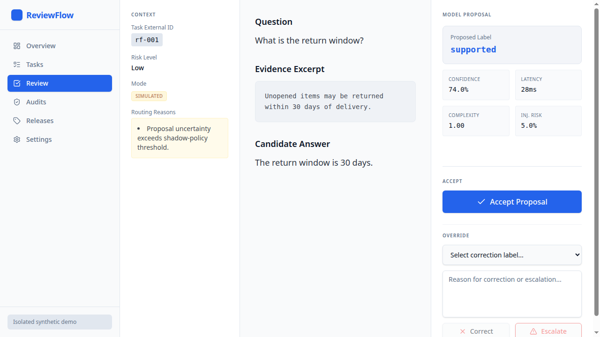

# ReviewFlow

ReviewFlow is an **experimental local review application** with two workloads:
the original evidence-labeling experience and **Trace2Preference**, which turns
authorized observable agent-run exports into human-reviewed comparison datasets.
Demo fixtures and no-key proposals are explicitly simulated—not production
traces, independent human reviews, or evidence of model quality.

Model proposals are suggestions, not ground truth. Human corrections retain the
reviewer's decision, reason, and provenance; exports preserve those judgments
rather than silently replacing them with a later model result.



*Actual synthetic-data capture of the original evidence-labeling workflow,
not a Trace2Preference screenshot.*

## What is implemented

- TypeScript application: React/Vite web UI, Express API and worker
- Python standard-library trace validation, context eligibility, grouped splits,
  Label Studio interchange, study assignment, and benchmark analysis
- PostgreSQL persistence through Drizzle ORM
- OpenAPI-derived React Query client and Zod schemas
- A deterministic, intentionally imperfect synthetic evaluator
- Separate leased-job worker and a local same-origin development proxy
- Optional Clerk mode with persisted project roles
- An optional Jev adapter behind explicit server configuration and owner consent

The supported first-run path is `APP_MODE=demo`. It needs neither hosted
authentication nor Jev credentials. See **[local setup](docs/setup.md)**.

## Quick start

With Node 24, pnpm 10.26.1, Python 3.11+, and PostgreSQL 16 tools (`initdb`, `pg_ctl`,
`createdb`) on your path:

```bash
pnpm install --frozen-lockfile
pnpm run demo:isolated
```

Open `http://localhost:5280`. In **Trace2Preference**, import the scripted sample
or an authorized [trace export](docs/trace-contract.md), inspect observed evidence
and actual responses, record a blind preference (or explicitly reveal assistance),
complete the quality check, and download a frozen dataset release. Missing
context, unmatched runs, and nonbinary outcomes stay in the complete record;
only eligible human-finalized directional preferences enter training JSONL.

The original **Tasks → Review → Releases** evidence-labeling path remains.
This command uses a temporary database; stopping it discards that demo only.
See [setup](docs/setup.md) and the reusable [Python CLI](docs/trace-python.md).

## Scope

This is a portfolio-quality prototype, not a production service or a claim of
model quality. Clerk/shared-role code is optional and is not a production
security certification. Paid evaluation is off by default; Jev connectivity has
not been live-tested. Imported text is inert. Shareable exports remove structured
private identities, but source text still requires a privacy review before sharing.
An optional [SPEAR capture exercise](docs/spear-capture.md) has been run locally
with scripted responders, not real models. No genuine human benchmark exists; see the
[study/capture boundaries](docs/trace-study.md) and exact
[verification results](docs/verification.md).

## Documentation

- [Setup and verification commands](docs/setup.md)
- [Configuration variable template](.env.example)
- [Architecture, tradeoffs, and limitations](docs/tradeoffs.md)
- [Executed verification and release status](docs/verification.md)
- [Security policy and operating boundaries](SECURITY.md)
- [Contributing](CONTRIBUTING.md)
- [Third-party notices and provenance](THIRD_PARTY_NOTICES.md)
- [OpenAPI contract](lib/api-spec/openapi.yaml)

Original ReviewFlow code is available under the [MIT License](LICENSE).
