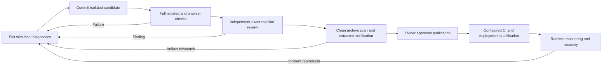

# Local launch candidate and release gates

This candidate is a locally verified prototype for source sharing and a synthetic demonstration. It is not a qualified hosted service, a provider benchmark, or evidence of independent human accuracy. No deployment, publication, invitations or paid inference are part of verification.

## What the system does

| Stage | Implemented behavior | Boundary |
|---|---|---|
| Data | Evidence import, content identity, trace contracts, context eligibility and grouped splits | Import only data you may use; source text needs privacy review |
| Evaluation and routing | Versioned policy lanes; leased evaluation worker; an explicit routing-advice API with rules, simulator or optional Jev | Rules remain authoritative; recommendations never accept, finalize or release data |
| Multiplayer | Shared projects, role revisions, expiring work assignments and server-checked source versions | Real account/session qualification remains pending |
| Live editing | WebSocket + Yjs concurrent editing of an evidence task's **shared notes**; PostgreSQL persistence and reconnect merge | Source evidence and final decisions are not collaborative text fields; trace preference forms retain version-conflict protection |
| Quality | Blind-exposure ledger, independent audit eligibility, disputes/adjudication, manual trace quality attestation | Scripted tests are not independent human qualification |
| Release | Frozen bytes/digests/provenance; quarantine/audit/privacy gates; portable source archive | Source publication and hosted rollout require separate approval |

The overview links these stages in order. An evidence reviewer sees source context before optional routing and team notes. “Copy into my reason” is explicit; submitting a label remains a separate action.

## Live-note trust and resource model

The HTTP ticket endpoint uses the existing authenticated project context, write-origin/CSRF protection and review roles. Tickets are random, single-use, origin-bound, expire after 30 seconds and never appear in URLs or logs. WebSockets accept only configured trusted origins. A connection lasts at most five minutes before reauthentication; membership is checked for every read/write and idle access is rechecked every five seconds. Revocation prevents new operations. Owners, reviewers and adjudicators can collaborate; auditor/exporter roles cannot.

Opening notes records exposure under the same actor lock used to start blind audits. Active independent audits cannot open notes for their sampled items. Finalized or quarantined evidence closes the scratchpad. Neither a note nor a transport frame can change a final label, task version or release.

Concurrent note edits merge with Yjs. The server validates each proposed update in a disposable document, accepts only one plain-text root and persists before acknowledging that specific update. Updates are capped at 48 KB encoded state and 2,000 text characters; the connection has message, editor-count and backpressure limits. A full CRDT history stops editing with a visible error. Local edits awaiting acknowledgement survive a socket reconnect while the page stays open; do not navigate away with unsent edits. Notes are private project data, excluded from dataset exports and retained with their task. Deleted text/history should not be treated as secure erasure.

**Deployment topology:** use one API process for this version. Tickets, connection limits, provider concurrency and immediate WebSocket fan-out are process-local. PostgreSQL persists notes across restarts. Multi-instance ticket routing, distributed limits and push fan-out are not qualified. Do not advertise general document co-editing or production-scale collaboration.

## Optional provider route

`POST /api/reviewflow/tasks/:taskId/routing-advice` requires an expected task version. `provider` defaults to `rules`; `simulator` is synthetic. `jev` requires Clerk mode, server live opt-in, signed-in project access, assistance-enabled policy, owner-enabled lifetime call budget and explicit approval of the exact outbound question/evidence/answer. Source data is limited to 32 KB. The existing typed Jev adapter is reused; there is no OpenAI adapter.

One potentially billed attempt is reserved before each call, including failures. The provider fetch has a two-second abort deadline, a 64 KB response limit, typed validation and no retries in this endpoint. At most one request per project and four per API process may call the provider concurrently; excess requests use policy fallback. A call cap is not a currency budget. Policy/source/membership are checked again after the response. Protected lanes cannot be overridden. Results include the measured request latency and a recommendation marked `applied: false` and `automaticAcceptance: false`; final human decisions and release gates remain separate. Jev latency, quality and billing have not been measured live.

## Repeatable verification

Use Node 24, pnpm 10.26.1, Python 3.11+ and PostgreSQL 16 tools. Native optional packages are retained for macOS/Linux builds; no private native-module shim is needed.

```sh
pnpm install --frozen-lockfile
pnpm run verify:isolated
pnpm --filter @workspace/scripts exec playwright install chromium
pnpm run test:browser
pnpm audit
```

The browser harness binds to loopback, requires an isolated disposable database, supplies explicit synthetic identities, prohibits live-provider requests and blocks external browser traffic. Production code has no synthetic-header authentication path. It exercises project creation, roles/assignment, two simultaneous note editors, reconnect, keyboard focus, routing preview, review, independent blind audit, export, revocation, desktop/mobile layout and axe WCAG A/AA checks. Axe does not replace manual assistive-technology testing. Browser captures use synthetic data only.

The backend suite exercises stale versions, parallel review fencing, job leases, provider failure and deadline, concurrent routing fallback, quarantine during a response, ticket replay, malformed CRDT state, role revocation, cross-project access and blind-audit exposure. Local routing samples report actual warm synthetic request observations; they are not live inference benchmarks.

For an exact clean source candidate, install a trusted gitleaks binary and run:

```sh
REVIEWFLOW_GITLEAKS=/path/to/gitleaks pnpm run verify:candidate
```

This command refuses a dirty checkout, creates a new temporary stage, excludes nested environment/credential files and unreviewed images, checks screenshot links, scans the candidate, produces a deterministic portable archive, extracts it and runs the full isolated harness there. It writes the revision, SHA-256 and verification manifest outside the repository. It does not publish anything. A directory scan does not clear Git history; scan the exact intended publication history separately.

## Quality baseline and ownership

Repository maintainers own these checks and this document. Refresh evidence on every candidate. Remote branch protection, CI success, deployed identity, backups and observability have not been demonstrated.

| Risk domains | Control and stage | Status / evidence |
|---|---|---|
| Syntax, compiler, types, generated declarations (1–3, 35) | TypeScript project rebuild and declaration regeneration, every full harness | Executable local gate |
| Static analysis, maintainability, duplicate/complex code (4–7) | Format new modules; semantic review of authorization, concurrency and provider boundaries | Partial; legacy router remains large; no complexity-score blocker |
| Architecture, domain contracts, API evolution (8–9, 13, 18) | Shared policy engine and typed endpoint validation; invariant regressions | Executable tests; new routes are handwritten, not in the generated OpenAPI client |
| Unit, generated cases, integration, journeys (10–14, 37) | CRDT merge order/idempotency cases, real WebSocket clients, isolated DB/API/browser tests | Synthetic; external provider/Clerk/Label Studio UI qualification pending |
| Visual, accessibility, localization (15–17) | Reviewed desktop/mobile captures, axe A/AA and keyboard focus | English only; screen-reader/manual zoom qualification pending |
| Migrations and recovery (19, 28, 33) | Additive committed migration; disposable fresh install and restart persistence | Production migration/backup/restore/rollback rehearsal pending |
| Vulnerabilities, secrets, supply chain, provenance (20–23) | Locked dependencies, minimum package age, advisory scan, gitleaks candidate scan, notices | Local evidence; scans describe their time and scope, not a security certification |
| Identity, tenant privacy, concurrency (24–25, 27) | Fresh role locks, origin-bound ticket, exposure lock, source/version fencing and CRDT validation | Synthetic role/security regressions; real session and multi-instance tests pending |
| Resources, reliability, cost (26, 28, 40) | State/payload/peer limits, single-use ticket, provider deadline, no retry and lifetime reservations | Process-local limits; live load/currency qualification pending |
| Build/artifact/configuration (29–31) | Frozen lock, portable package, clean extracted-source verification | Local macOS execution; Linux CI configured but remote result unverified |
| Observability and operations (32–33) | Safe structured errors/logging; worker health and explicit fallback signals | TLS, monitoring, retention, abuse controls, backups and operator ownership required before hosting |
| Documentation, release policy, agent/onboarding knowledge (34, 36, 38–39) | Setup, candidate manifest, scoped independent code review and separate publish approval | No push/merge/deploy; remote enforcement unknown |



The minimum baseline is these executable gates plus human semantic review. No pre-commit full suite, vanity coverage threshold or automated model approval is required. CI is configured for the full local-equivalent harness and synthetic browser tests; activation/branch policy remains an operator task. A blocking failure requires a fix and fresh candidate; any exception must name the risk, owner, scope and expiry in the review record. Maintain a small scorecard: candidate pass/fail by exact revision, repeated defects with a regression, unqualified external integrations, and time to reproduce a failed journey. Historical baselines are unknown.

Adoption order is: inspect risks → local foundations → required PR gates → deployed identity/recovery qualification → maintained agent instructions and reproduction recipes → targeted load/property testing driven by real failures. Current work completes local foundations and configures PR checks; it does not establish hosted-service maturity.

## Remaining release gates

- Independent review of the final exact revision and artifact evidence; fix material findings before sharing.
- Real Clerk accounts, session expiry/revocation, production origin/TLS configuration and deployment-specific privacy/abuse checks.
- Authorized bounded live provider qualification and independent human reference study before provider quality/speed claims; no automated acceptance.
- Production migration/backup/restore rehearsal, monitoring, retention/deletion policy and an operational owner.
- Separate explicit authorization to push, publish or deploy. Public claims must describe shared-note scope, synthetic verification and unqualified integrations accurately.
